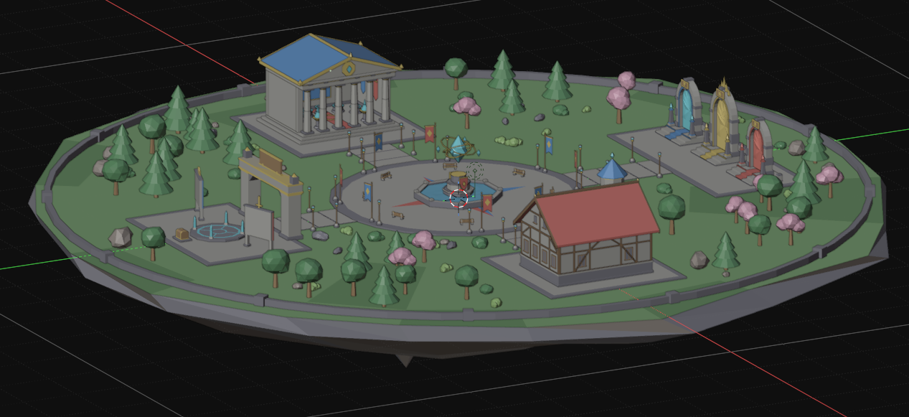
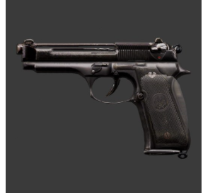
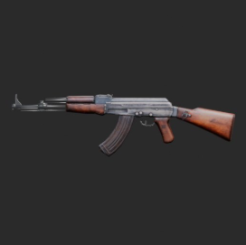
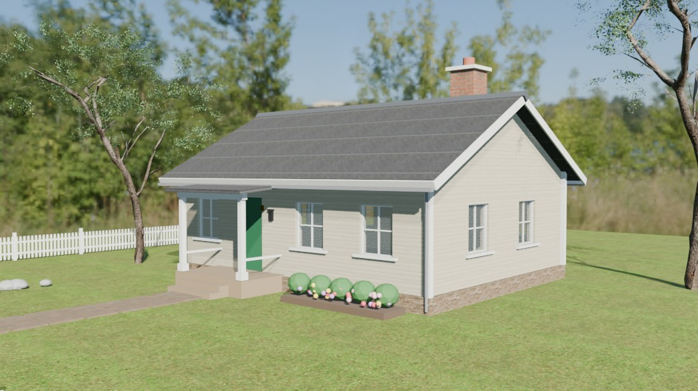
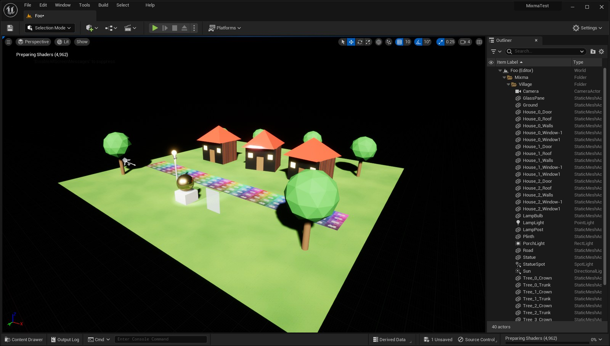

<p align="center"></p>

# Unix

You type what you want. Unix builds it in 3D, renders it from every side, measures what is wrong, fixes it, and can drop the result straight into Unreal, Unity, Godot or a Roblox Studio place you have open.

It is a desktop app for Windows built on Blender 4.5. The AI is Claude, running through your own Claude Code login. You don't need an API key, there is no Unix server, and there is no Unix account.

**Download:** [Releases](../../releases) → `Unix-Setup-0.1.0.exe` (366 MB, Windows 10/11, 64-bit).

---

## Things it made

Every picture below is a real run of the app: one typed prompt, no hand edits afterwards. The times and costs are what Claude Code reported for the run.

### A whole Roblox map



A complete hub map on a floating island. It has a temple, three portal gates, a spawn plaza with a fountain, a quest board area, a timber-framed shop, lamps, banners, benches, and pine and cherry trees all the way around the edge. Every building and prop is a separate part. The whole map is sized for Roblox and goes into Studio over the live link.

### "make a realistic m9 pistol" / "make a realistic ak47"

<p>


</p>

**M9: 131 seconds, $0.58. AK-47: 120 seconds, $0.66, 18 parts.** Nobody modelled these by hand. Unix found photos of the real gun on Wikimedia Commons and traced the true outline from a side-on photo. It built every part as a solid, turned the AK's barrel as a real tube with a bore, then laid the photo over the finished shape so the wood and steel are the real thing.

<sub>Surface photos: "Berretta M9 (no background)" by Curiosandrelics, CC BY-SA 3.0; "AK-47 type II noBG" by Nemo5576, CC BY-SA 4.0; both via Wikimedia Commons. These renders are shared under the same licences.</sub>

### "make me a house"



**About 8 minutes, about $1.20.** In team mode the lead agent writes one design and splits the job, here into three helpers working at the same time (house, garden, light). It then joins the parts and checks the scene: zero flickering surfaces and nothing floating. The trees, grass and textures are free CC0 assets from Poly Haven, which Unix downloads by itself.

### Sent live into a running Unreal Editor



A test village went from Blender into the open Unreal level as 40 actors. It arrived with its lights, materials and camera, inside its own outliner folder. Sending it again replaces it. No files were dragged and no import dialog was used.

---

## What it can actually do

- **It looks at its own work.** After building, Unix renders views, all six sides or a close-up of the bones inside a mesh, and looks at the pictures before it says it's done. When it makes something "realistic" or animates a character without watching it, the app sends it back for a second look.
- **It measures instead of guessing.** It checks for flickering faces, objects floating above the ground, things stuck inside each other, broken rigs, feet sliding through the floor, and limbs passing through each other in animations.
- **It finds reference photos.** It looks up freely licensed photos of the real thing, traces their silhouettes and projects them as surfaces. Photo credits are saved next to the photos.
- **It rigs anything.** It measures a creature's limbs (arms, legs, tails, fingers, wing spars), builds bones down their centre lines, and binds the mesh without it moving or tearing. Tested on human arms and a dragon with membrane wings.
- **Real human motion.** It searches about 2,600 recordings of real people (the CMU motion capture library), puts the clip on your character whatever its bone names, keeps planted feet planted, and closes the loop for a game cycle. Walk, run, strafe, backpedal and idle came out on one character in 4 minutes 18 seconds, for $0.86.
- **Real fire and smoke.** It runs real gas simulations, baked a few frames at a time so the window never freezes. It also has instant procedural columns of fire, smoke, dust, steam and energy.
- **Goals that run for hours.** Type `/goal` followed by the whole job. It works round after round, for up to 24 hours. A fresh agent that didn't build the scene has to agree the goal is met before it stops. One goal pulled more than 3,000 asset files into one scene, stripped out every building as asked, and wired up 29,277 sounds and 32 animated effects.
- **Whole Roblox maps.** It can build a full map in one go, from the ground and buildings to the paths, props, trees and lighting, and send it straight into the Studio place you have open.
- **Game engines:**
  - **Roblox Studio:** a live link through a plugin that Unix installs. Simple shapes become native Parts. Meshes arrive with colour, normal, roughness and metal maps. Rigged characters arrive skinned, with their animations playing. Looping effects arrive filmed and play as flipbooks.
  - **Unreal:** a live link into the open level.
  - **Unity and Godot:** assets are written straight into the project, at the right scale and axes.
- **Safety:**
  - Every turn is one Ctrl+Z.
  - Snapshots are taken before changes.
  - It switches to a lighter view when a full render would run your PC out of memory.
  - After a crash, Unix reopens your work and carries on.

## What it can't do

- **It doesn't generate meshes.** Unix doesn't send your prompt to a 3D model generator. It builds with Blender the way a person would: parts, outlines, photos and scripts. Hard-surface objects and buildings come out well. A realistic human or animal face built from nothing will not look film-real.
- **"Realistic" means close and recognisable, not photoreal.** The guns above are the honest current level.
- **Windows only.** The engine underneath runs elsewhere, but the installer, launcher and live links are written for Windows.
- **It runs on your Claude plan.** Every run uses your Claude Code usage. Long goals use a lot of it.
- **Big scenes need memory.** Scenes with thousands of objects need a lot of RAM. Unix checks before heavy renders, but 16 GB or more is recommended.
- **Untested in Roblox:** skinned characters and full surface maps after they are uploaded to a Roblox account have not been checked end to end in a published game.

## Install

1. Install [Claude Code](https://docs.anthropic.com/en/docs/claude-code/setup), open a terminal, run `claude` once, and sign in with your Claude account.
2. Run `Unix-Setup-0.1.0.exe`. It installs for your user only, with no admin rights. Windows SmartScreen may say "Windows protected your PC" because the installer isn't code-signed: click **More info**, then **Run anyway**.
3. Open Unix from the Start menu and type in the box at the bottom.

**Beginner** shows only the viewport and the chat. **Advanced** shows all of Blender.

## Build from source

The add-on is in `unix/`. See [docs/DEVELOPER.md](docs/DEVELOPER.md) for the full tool list and [docs/ARCHITECTURE.md](docs/ARCHITECTURE.md) for how it fits together.

```
python scripts/build_app.py        # portable app from a Blender 4.5 install
python scripts/build_release.py    # the installer, in dist/
scripts/run_tests.ps1              # 20 test suites, no model calls, no internet
```

## License

Copyright (C) 2026 Larpbase. Unix is free software under the [GNU GPL v3 or later](LICENSE), like the Blender it is built on. See [NOTICE.txt](NOTICE.txt) for credits. Unix is not made or endorsed by the Blender Foundation or Anthropic.
